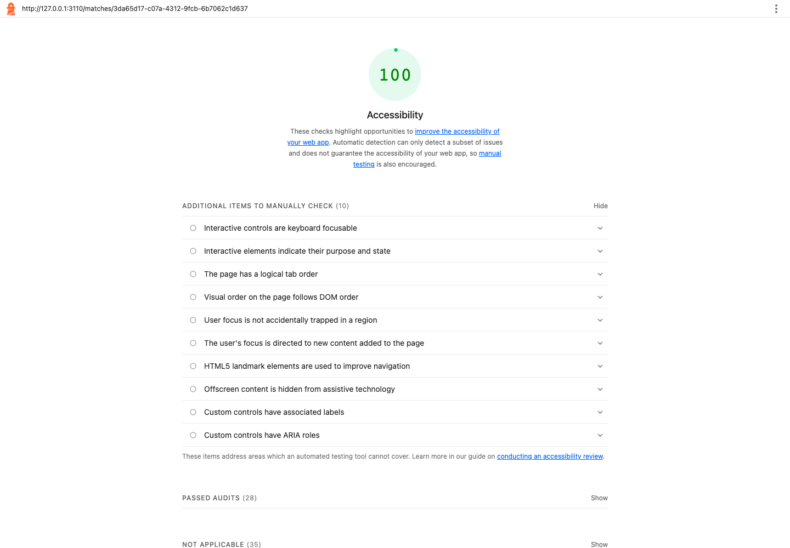

# Accessibility audit

Audit date: November 5, 2026 (America/Detroit). Application: BattleAI. Base revision: `01014821288e89f34aeb6d29a6bcfdfe31bffce1`.

## Submission status

Local fixes, automated checks, score screenshots and a keyboard demonstration are included. **The PageSpeed Insights audit and live publication are still pending a public website URL/deployment target.** The owner confirmed that BattleAI is not hosted yet. Localhost is not a publicly reachable website. These screenshots are genuine local Lighthouse results, not PageSpeed Insights results. Do not submit them as proof of a completed PageSpeed Insights audit.

## Scope and method

Audited Log in, Register, Rankings, Agent, Matches and match pages for Tic-tac-toe, Four, Checkers and Fleet. Used disposable in-memory fixtures with public and authenticated views, without saved development accounts or live model calls.

Tools: Lighthouse 13.6.0, axe-core/Playwright integration 4.14.0, Playwright 1.63.0 and Node 24.11.1. Lighthouse covered desktop (1440 × 1000) and mobile emulation (390 × 844); automated axe checks covered widths 1440 and 390. Chromium keyboard tests exercised actual Tab, Shift+Tab, Enter, Home, End and arrow-key input. This does not certify other browsers, physical devices or screen-reader behavior.

## Findings and fixes

1. **Activity labels omitted visible text.** All four games had replay buttons whose `aria-label` omitted event type/sequence or changed visible coordinate wording. Lighthouse reported `label-content-name-mismatch` even though the aggregate score was 100. Buttons now derive their accessible names from their visible content, with a hidden “Show position after” prefix. Redundant graphics are hidden from assistive technology inside those buttons. Capture and promotion information remains in the name.
2. **Replay boundary actions lost focus.** Activating Previous at position 1 disabled that button and moved focus to the document body. The same risk applied to Next and Return to latest. Focus now returns to the labelled replay slider when the active control becomes disabled. It does not move when another element is active.
3. **Skip-link destination was not explicitly focusable.** Chromium bypassed navigation, but the main region did not receive focus. `tabindex="-1"` now makes it the explicit destination without adding a Tab stop.
4. **Registration password instructions were not associated with the field.** The eight-character hint is now connected with `aria-describedby` and verified as the field's accessible description.
5. **Entrance animation temporarily reduced text contrast.** An axe run measured activity metadata at 4.46:1 against the selected card while opacity was animating. Removed the opacity fade; retained the small movement and reduced-motion behavior. No contrast checks were disabled or delayed to conceal this state.

The existing Castling palette, typography, visible focus rings, native form controls and board coordinates are retained.

## Results and evidence

All nine final pages scored **100/100 accessibility** in local Lighthouse on desktop and mobile, with no failed audits in the captured results. Baseline desktop scores were also 100; the baseline reports still flagged the label mismatch described above. A perfect automated score does not cover every accessibility requirement; Lighthouse excludes manual and some best-practice checks from scoring ([scoring documentation](https://developer.chrome.com/docs/lighthouse/accessibility/scoring)).

- [Baseline results](docs/accessibility/before/results.json) and [representative baseline report](docs/accessibility/before/fleet.html).
- [Final desktop results](docs/accessibility/final-desktop/results.json) and [report](docs/accessibility/final-desktop/fleet.html).
- [Final mobile results](docs/accessibility/final-mobile/results.json) and [report](docs/accessibility/final-mobile/fleet.html).

Validation: 269 unit/integration tests passed; build and both TypeScript checks passed; all 19 browser workflows passed. The new browser suite runs axe on all nine pages at both widths, including the label-content rule, and verifies skip-link focus, password help and keyboard focus at replay boundaries. Existing capture/promotion assertions were updated to match native name spacing. Initial failures were retained as diagnostic evidence before correction, not bypassed with retries.

Independent code review found no actionable issues after fixes. Focused Clef review of replay focus returned `no_defect_demonstrated`, evidence gap `none`; digest `7c5950dbbfca09db25d65294391a2c1c52e894e3acad4af8c3f56784ea9007c5`. This is advisory, not accessibility certification. GitHub CI status is recorded on the delivery PR.

## Keyboard walkthrough

[Watch the approximately 90-second keyboard demonstration](docs/accessibility/keyboard-demo.webm). It shows login, navigation to Agent, the tactics disclosure, Rankings, match history and replay. The overlay captions actual navigation keys; there are no mouse clicks after the initial page load. Test credentials are disposable fixtures.

**This is an automated demonstration, not a recording of the student.** If the assignment requires you personally to perform the walkthrough, record yourself following the same route with keystroke captions or narration. Suggested timing: 0–20s login/skip link; 20–40s Agent fields/tactics; 40–60s Rankings/navigation; 60–100s replay slider, boundary buttons and activity selection.

To reproduce the demonstration locally, build the app, start `E2E_PORT=3110 npm run test:e2e:serve`, then run `node scripts/record-keyboard-demo.mjs`. The recorder only targets that fixture server. To rerun regression checks, use `npm test` and `npm run test:e2e` on Node 24.11.1.

## Remaining PageSpeed Insights and publication steps

1. Supply the public deployment URL and publish the reviewed fixes to that deployment. Committing/pushing source to GitHub does not publish a running Node/SQLite application.
2. Enter the public URL in [PageSpeed Insights](https://pagespeed.web.dev/), run mobile and desktop, and address any deployment-specific accessibility failures. The service cannot audit private signed-in pages; retain local authenticated-page checks as supplemental evidence.
3. Save the real PageSpeed Insights 100-score screenshot and result URL here, including audit date and tested route. No PageSpeed score is claimed until that run succeeds.
4. Confirm whether the instructor accepts the clearly labelled automated demonstration; otherwise submit your own 1–2-minute recording.

Deployment requirements from the current code: a persistent Node 24 process, a writable persistent location for `DATABASE_PATH`, `npm ci && npm run build`, then `npm start`, and HTTPS at the public endpoint. `src/server.ts` currently binds to `127.0.0.1`; a container host needs an explicit interface-binding change, while a same-host reverse proxy can use loopback. Hosting selection and any account/billing decision are pending. Keep the fixture server and its known test credentials local; publish the application server, never the fixture server.
